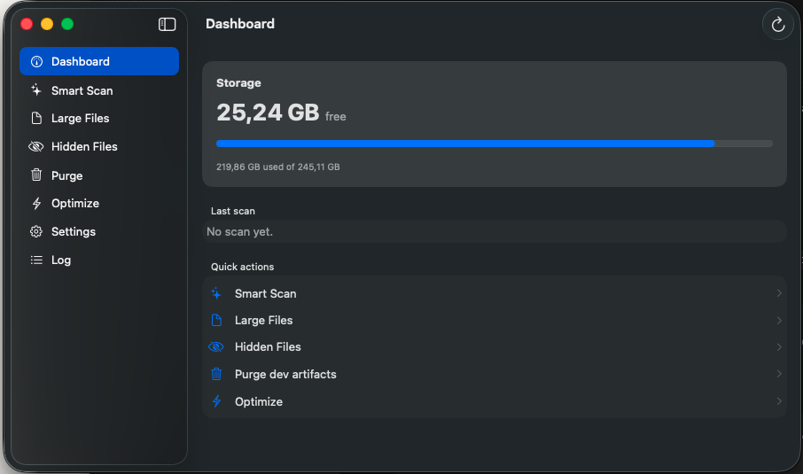

# MacCleaner

A fast, native macOS cleaner app built with SwiftUI. Scan your filesystem for unnecessary files, review them before deletion, and safely free up disk space.



## Features

- **Smart Scan** – Scans common locations (`~/Library/Caches`, `~/Library/Logs`, `~/.Trash`, `~/Library/Developer/Xcode/DerivedData`) for removable files
- **Large Files** – Find and review large files taking up space
- **Hidden Files** – Discover hidden files and dotfiles
- **Purge Dev Artifacts** – Clean `node_modules`, `target`, `.build`, `DerivedData`, and other build artifacts
- **Optimize** – Flush DNS cache, rebuild QuickLook and icon caches
- **Settings & Whitelist** – Protect specific paths from accidental deletion
- **Safe by Default** – Files are moved to Trash, dry-run mode available, confirmation dialogs before deletion
- **Non-Blocking UI** – Operations run asynchronously to keep the interface responsive

## Requirements

- macOS 13.0 (Ventura) or later
- Apple Silicon or Intel

## Installation

### From DMG
1. Download `MacCleaner-<version>.dmg` from [Releases](https://github.com/l3vram/MacCleaner/releases)
2. Open the DMG and drag `MacCleaner.app` to your `Applications` folder
3. Launch from Applications

The app is not notarized. On first launch, right-click `MacCleaner.app` → **Open**.

### Build from Source
```bash
git clone https://github.com/l3vram/MacCleaner.git
cd MacCleaner
xcodebuild -project MacCleaner.xcodeproj -scheme MacCleaner -configuration Release build
```

If you change `project.yml`, regenerate the project with [XcodeGen](https://github.com/yonaskolb/XcodeGen) (`xcodegen generate`).

Run the tests:
```bash
xcodebuild -project MacCleaner.xcodeproj -scheme MacCleaner test
```

## Usage

1. Launch MacCleaner
2. Go to **Smart Scan** and click **Scan**
3. Review detected files by category
4. Select categories to clean (turn on **Dry run** to preview without deleting)
5. Click **Clean** and confirm – files are moved to the Trash, so you can still restore them
6. To reclaim the space, click **Empty Trash…** and confirm – this is permanent

## Safety

- Clean moves files to the Trash; it never deletes them permanently
- Emptying the Trash is a separate action with its own confirmation showing how much will be freed
- System paths (`/System`, `/usr`, `/bin`, etc.) are protected
- The whitelist in Settings protects any directory you choose
- Every operation is logged to `~/Library/Logs/MacCleaner/operations.log` (viewable in the **Log** tab)

## License

This project is licensed under the MIT License – see the [LICENSE](LICENSE) file for details.

## Disclaimer

This software is provided as-is. Always review files before deletion. The author is not responsible for any data loss.
